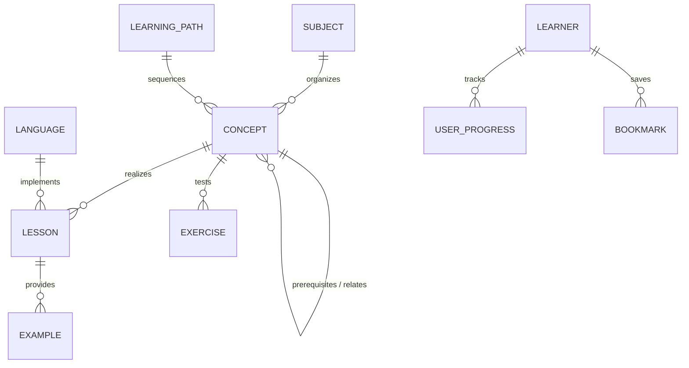

# Lumenode Data Model Specification

## 1. Entity-Relationship Overview



## 2. Core Schemas (TypeScript / Zod definitions)

### 2.1 Subject
Represents a broad knowledge domain (e.g., Programming Languages, Core CS).
```typescript
export interface Subject {
  id: string; // e.g. "dsa", "c-programming", "dbms"
  title: string;
  slug: string;
  description: string;
  category: 'programming-languages' | 'core-cs' | 'laboratories';
  icon: string;
  order: number;
}
```

### 2.2 Concept
Canonical, language-agnostic computer science concept.
```typescript
export interface Concept {
  id: string; // e.g. "dsa.singly-linked-list"
  subjectId: string;
  title: string;
  slug: string;
  description: string;
  prerequisiteConceptIds: string[];
  relatedConceptIds: string[];
  difficulty: 'beginner' | 'intermediate' | 'advanced';
  tags: string[];
}
```

### 2.3 Lesson
A structured unit of learning adhering to the lesson engine specification.
```typescript
export interface Lesson {
  id: string; // e.g. "c.linked-lists.basics"
  conceptId: string;
  languageId?: string; // e.g. "c", "cpp", "python", or undefined if purely theoretical
  title: string;
  slug: string;
  summary: string;
  difficulty: 'beginner' | 'intermediate' | 'advanced';
  estimatedMinutes: number;
  sections: LessonSection[];
  version: string;
}

export type LessonSection = 
  | { type: 'heading'; level: 1 | 2 | 3 | 4; text: string }
  | { type: 'markdown'; content: string }
  | { type: 'code'; language: string; code: string; title?: string; executable?: boolean }
  | { type: 'visualization'; visualizerType: 'dsa' | 'memory' | 'oop' | 'custom'; config: Record<string, unknown> }
  | { type: 'callout'; variant: 'note' | 'tip' | 'warning' | 'deep-dive'; title?: string; content: string }
  | { type: 'comparison'; headers: string[]; rows: string[][] }
  | { type: 'quiz'; exerciseId: string };
```

### 2.4 Visualization Trace State
For deterministic step-by-step simulations.
```typescript
export interface VisualStep<TState> {
  stepIndex: number;
  title: string;
  description: string;
  state: TState;
  highlightedIds?: string[];
  actionType?: string;
}

export interface VisualSequence<TState> {
  id: string;
  conceptId: string;
  initialState: TState;
  steps: VisualStep<TState>[];
}
```

### 2.5 UserProgress & Local Persistence (IndexedDB)
```typescript
export interface UserProgress {
  lessonId: string;
  status: 'not_started' | 'in_progress' | 'completed';
  lastAccessedAt: number;
  completedSections: string[];
  quizScores: Record<string, number>;
  notes?: string;
}

export interface Bookmark {
  id: string;
  targetId: string;
  targetType: 'lesson' | 'concept' | 'exercise' | 'laboratory';
  createdAt: number;
}
```
