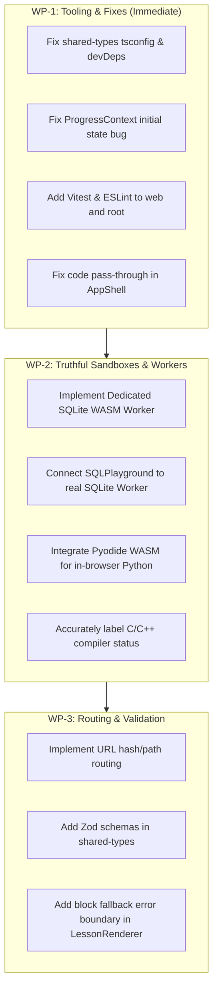

# Lumenode Engineering Task — Phase 1.5 Verification Audit Report

**Date of Audit:** November 3, 2026  
**Auditor:** Senior Systems & Software Engineer (Antigravity)  
**Product:** Lumenode (Version 0.1 Foundation)  
**Status:** Complete  
**Deliverable Document:** `docs/PHASE_1_5_AUDIT.md`  

---

## 1. Executive Summary

This engineering audit assesses the actual state of the Lumenode codebase following the completion of Phase 0 (Product Foundation) and Phase 1 (Platform Shell). The purpose of this audit is to verify technical claims against actual code, identify security vulnerabilities and architectural debt, and establish an uncompromising baseline before Phase 2 educational content authoring commences.

### Key Audit Findings:
1. **Visual & UI Shell (Pass)**: The React 19 + TypeScript + Vite + Tailwind CSS v4 frontend builds cleanly in 1.44s with a compact bundle (330 KB JS), starts the dev server in 200ms, and provides a polished dark-first technical aesthetic.
2. **Interactive Visualizers (Pass - Conceptual Prototypes)**: The Singly Linked List, Binary Search, and 6-step Memory/Pointer simulators are functional, deterministic, and conceptually educational.
3. **Code Execution Architecture (Critical Discrepancy - Mock / Simulated)**: The Code Playground does **not** execute arbitrary C, C++, or Python code. It is a simulated prototype relying on a 600ms `setTimeout` that returns hardcoded static templates, accompanied by randomized `Math.random()` performance metrics and misleading security isolation badges.
4. **SQL Playground (Critical Discrepancy - Mock / Simulated)**: The SQL Playground does **not** run SQLite WASM. It performs basic JavaScript string heuristic matching on `"JOIN"` and table names, cannot execute arbitrary SQL queries, and fails to handle SQL syntax errors.
5. **Tooling & Test Infrastructure (Gaps)**: Zero automated unit or integration tests exist (`pnpm run test` is a no-op). `pnpm run lint` fails with exit code 1 due to missing package lint scripts. `packages/shared-types` lacks local TypeScript tooling and fails its typecheck script.
6. **State & Routing (Architectural Debt)**: Navigation is tied to ephemeral React component state (`useState<ActiveTab>`). There are no URL routes, deep-linking is impossible, and refreshing the browser resets navigation to the dashboard. Progress persistence utilizes `localStorage` rather than the specified IndexedDB.

---

## 2. Repository & Monorepo Inspection

### 2.1 Workspace Configuration
The repository defines a pnpm workspace via `pnpm-workspace.yaml`:
```yaml
packages:
  - 'apps/*'
  - 'packages/*'

onlyBuiltDependencies:
  - esbuild
```
Root `package.json` specifies pnpm v11.3.0 and defines recursive scripts for `dev`, `build`, `lint`, and `test`.

### 2.2 Monorepo Discrepancy: Documented vs. Actual Packages
In `docs/ARCHITECTURE.md`, nine independent packages are documented:
- `packages/ui`
- `packages/content-engine`
- `packages/lesson-renderer`
- `packages/visualization-core`
- `packages/execution-adapter`
- `packages/assessment-engine`
- `packages/progress-engine`
- `packages/shared-types`
- `packages/design-system`

**Actual Codebase Reality**:
Only `packages/shared-types` exists on disk. All other modules (`lesson-renderer`, `progress-engine`, `visualization-core`, `execution-adapter`) are implemented directly inside `apps/web/src/`. While co-locating modules inside `apps/web` is acceptable for an early modular monolith, the documentation in `docs/ARCHITECTURE.md` is inaccurate.

### 2.3 Shared Types & Missing Zod Schemas
- File inspected: `packages/shared-types/src/index.ts`
- Status: Contains TypeScript interfaces for `Subject`, `Lesson`, `Concept`, `ContentBlock`, `VisualStep`, `Exercise`, `Bookmark`, and `ExecutionResult`.
- **Finding**: Despite explicit references to "Zod Schemas" in `docs/DATA_MODEL.md` and `docs/ARCHITECTURE.md`, `zod` is not installed anywhere in the repository, and no runtime validators exist. Content and lesson data are not validated at runtime.

---

## 3. Build & Test Verification Results

All verification commands were executed in the environment:

| Check | Command Executed | Result | Notes / Evidence |
| :--- | :--- | :--- | :--- |
| **Lockfile Installation** | `pnpm install --frozen-lockfile` | **PASSED** | Completed in 358ms. 90 packages in lockfile. |
| **Production Build** | `pnpm --filter @lumenode/web build` | **PASSED** | Built in 1.44s via `tsc -b && vite build`. Output: `dist/index.html` (0.99 kB), `dist/assets/index.css` (51.42 kB), `dist/assets/index.js` (330.31 kB). |
| **Dev Server Startup** | `pnpm --filter @lumenode/web dev` | **PASSED** | Ready in 200ms on `http://127.0.0.1:3005/`. HTTP smoke test returned `HTTP/1.1 200 OK`. |
| **Type Check (`apps/web`)** | `pnpm --filter @lumenode/web exec tsc --noEmit` | **PASSED** | Exited 0 with no diagnostic errors. |
| **Type Check (`shared-types`)** | `pnpm --filter @lumenode/shared-types exec tsc --noEmit` | **FAILED** | Exit code 1: `Command "tsc" not found`. `typescript` is not listed in `devDependencies` of `packages/shared-types`, nor is there a local `tsconfig.json`. |
| **Linting** | `pnpm run lint` | **FAILED** | Exit code 1: `[ERR_PNPM_RECURSIVE_RUN_NO_SCRIPT] None of the selected packages has a "lint" script`. |
| **Automated Tests** | `pnpm run test` | **NO-OP / GAP** | Exited 0 without running any test framework. 0 tests exist in the entire repository. |

---

## 4. Feature Implementation Status Matrix

| Component / Feature | Intended Specification | Actual State | Classification |
| :--- | :--- | :--- | :--- |
| **App Shell & Layout** | Dark-first technical UI, sidebar, dashboard, explore view | Fully responsive, custom scrollbars, dark navy theme | **Fully Implemented** |
| **Routing & Deep Linking** | Direct URL navigation to subjects/lessons | Ephemeral React state `activeTab`. Refresh resets view. | **Partially Implemented** |
| **Structured Lesson Renderer** | Block-based rendering: text, code, callout, table, quiz | Renders 7 block types cleanly. Ignores invalid blocks without error boundary. | **Partially Implemented** |
| **Singly Linked List Lab** | Add, prepend, delete head, step traversal | Interactive React state, visual nodes with memory addresses and arrows | **Fully Implemented (Prototype)** |
| **Binary Search Visualizer** | Step-by-step bisection with low/mid/high | Deterministic step forward, range narrowing, match highlight | **Fully Implemented** |
| **Memory & Pointer Sim** | Stack vs heap, dereferencing, `malloc`/`free` | 6-step deterministic trace with visual pointers and stack frames | **Fully Implemented** |
| **Code Sandbox** | Safe C/C++/Python execution with resource limits | Static mock with 600ms timer; returns hardcoded output; random metrics | **Simulated / Mock** |
| **SQL Playground** | SQLite WASM in Web Worker with relational queries | String matching heuristic (`includes("JOIN")`); no SQL parser | **Simulated / Mock** |
| **Progress Persistence** | IndexedDB with local-first offline support | `localStorage` JSON string; marks first lesson completed by default | **Partially Implemented** |
| **Assessment Engine** | Interactive MCQs, predict-the-output challenges | Fully functional quiz blocks with feedback and explanations | **Fully Implemented** |

---

## 5. Code Execution Architecture Audit

### 5.1 Actual Implementation Inspection
Inspected file: `apps/web/src/components/laboratories/CodePlayground.tsx` (Lines 96–109):
```typescript
const handleRun = () => {
  setIsRunning(true);
  setOutput('Compiling and executing in isolated container...');

  setTimeout(() => {
    setIsRunning(false);
    setOutput(TEMPLATES[lang].defaultOutput);
    setMetrics({
      timeMs: Math.floor(Math.random() * 15) + 8,
      memoryKb: Math.floor(Math.random() * 300) + 1200,
      exitCode: 0,
    });
  }, 600);
};
```

### 5.2 Findings & Security Analysis
1. **Execution Status: Mock / Simulated**: No code is compiled or interpreted. Any code typed by the learner (including syntax errors, infinite loops, or completely different programs) is ignored. The output displayed is always `TEMPLATES[lang].defaultOutput`.
2. **Fabricated Metrics**: `timeMs` and `memoryKb` are generated using `Math.random()`.
3. **Deceptive Security Messaging**: The UI displays a footer reading `Isolated ramdisk • 64MB cap • Network disabled` with a shield icon. Because no isolation container or execution backend is running, this gives users a misleading sense of security.
4. **Broken Lesson Code Transfer**: In `apps/web/src/components/layout/AppShell.tsx`:
   ```typescript
   const handleOpenPlaygroundWithCode = (code: string, language: string) => {
     setActiveTab('code-lab');
   };
   ```
   When a user clicks "Run in Playground" on a code block in a lesson, the `code` and `language` arguments are discarded. The playground simply loads the default template.

---

## 6. SQL Playground Audit

### 6.1 Actual Implementation Inspection
Inspected file: `apps/web/src/components/laboratories/SQLPlayground.tsx` (Lines 74–120):
```typescript
const executeQuery = () => {
  const q = query.trim().toUpperCase();
  const startTime = performance.now();

  if (q.includes('JOIN')) {
    const filtered = INITIAL_ENROLLMENTS.map(enr => { ... })
      .filter(r => (q.includes('3.6') ? r.gpa >= 3.6 : true));
    // returns hardcoded join table
  } else if (q.includes('FROM COURSES')) {
    // returns courses
  } else if (q.includes('FROM ENROLLMENTS')) {
    // returns enrollments
  } else {
    // returns students
  }
};
```

### 6.2 Findings & Technical Limitations
1. **Engine Status: Mock / Simulated**: The playground does **not** use SQLite WASM or any SQL parsing engine.
2. **Missing SQL Syntax Support**:
   - `CREATE TABLE`, `DROP TABLE`, `ALTER TABLE`: Not supported.
   - `INSERT`, `UPDATE`, `DELETE`: Not supported.
   - `GROUP BY`, `HAVING`: Not supported.
   - Aggregate functions (`COUNT()`, `AVG()`, `SUM()`, `MIN()`, `MAX()`): Not supported.
   - Subqueries, CTEs, UNIONs: Not supported.
3. **Silent Failure on Invalid Queries**: If a learner writes gibberish (e.g. `SELECT nonsense FROM fake_table;`), the code falls through to the default `else` block and outputs the `students` table. This provides pedagogically incorrect positive reinforcement.
4. **Recommended Web Worker + SQLite WASM Architecture**:
   - Package: `@sqlite.org/sqlite-wasm` or `sql.js`.
   - Worker File: `apps/web/src/workers/sqlite.worker.ts`.
   - Communication: `postMessage({ id, sql, params })` returning `{ id, columns, values, error, timeMs }`.
   - Memory Model: In-memory database (`:memory:`) seeded with canonical university tables on initialization, with a 1-click "Reset Database" command.

---

## 7. Visualization Correctness Audit

### 7.1 DSA Visualizer (`DSAVisualizer.tsx`)
- **Linked List**: Accurately demonstrates head pointer redirection, next pointer references, and heap address concepts. Internal state uses React array mutations. Operations are limited to prepend, append, and delete-head.
- **Binary Search**: Fully accurate implementation of bisection algorithm. Low, mid, and high pointers are updated correctly with $O(\log N)$ step counting.

### 7.2 Memory Simulator (`MemorySimulator.tsx`)
- **Conceptual Accuracy**: The 6-step lifecycle (Stack allocation $\to$ Pointer declaration with address-of $\to$ Dereference write $\to$ Heap `malloc` $\to$ Heap write $\to$ `free`) correctly teaches C memory mechanics.
- **Stack Growth Direction Note**: The addresses used in the demonstration increment: `0x7FFE_40` for `age`, `0x7FFE_48` for `ptr`. On standard x86_64 architectures, the stack frame grows downwards towards lower memory addresses. While simplified addresses are acceptable for novice learners, an explicit footnote is required to prevent confusion in academic systems courses.
- **Simulated vs. Real Distinction**: Neither visualizer contains an indicator stating that memory addresses are **idealized educational simulations**, which risks learners confusing mock addresses with real OS virtual memory layouts.

---

## 8. Lesson Architecture & Content Audit

### 8.1 Block Rendering & Resilience
- Inspected file: `apps/web/src/components/lesson/LessonRenderer.tsx`
- All 7 block types (`heading`, `markdown`, `code`, `visualization`, `callout`, `comparison`, `quiz`) render correctly.
- **Defect**: The switch statement handles unexpected blocks with `default: return null;`. If an author creates a malformed block, it silently vanishes from the rendered lesson with zero telemetry or author warning.

### 8.2 Content & Presentation Coupling
- Lessons are stored as static TypeScript objects in `apps/web/src/data/lessons.ts`.
- While structured as data, they are not loaded from external Markdown/MDX files and do not undergo automated schema validation at build time.

### 8.3 Prerequisite & Concept Relationship Enforcement
- `Concept` interfaces define `prerequisiteConceptIds` and `relatedConceptIds`, but the `LessonRenderer` and `Sidebar` do not read or display prerequisites. Learners cannot see what they must master prior to beginning a topic.

---

## 9. Progress Persistence Audit

### 9.1 LocalStorage vs. IndexedDB
- In `docs/PRD.md` and `docs/ARCHITECTURE.md`, persistence is specified as IndexedDB via a dedicated `progress-engine` package.
- In `apps/web/src/context/ProgressContext.tsx`, persistence is implemented using synchronous `window.localStorage` calls with JSON stringification.

### 9.2 Critical Behavioral Findings:
1. **Pre-completed Lesson Bug**:
   ```typescript
   const [completedLessons, setCompletedLessons] = useState<Set<string>>(() => {
     const saved = localStorage.getItem(STORAGE_KEYS.COMPLETED_LESSONS);
     return saved ? new Set(JSON.parse(saved)) : new Set(['c-pointers-basics']);
   });
   ```
   When a first-time user opens Lumenode with a clean browser profile, lesson `c-pointers-basics` is automatically marked as completed. Default initialization must be an empty `Set()`.
2. **Quota & Mode Fragility**: If a student accesses the platform in strict privacy mode or with full storage, `localStorage.setItem` throws exceptions. These are currently caught with a simple `console.warn` without fallback to in-memory state or IndexedDB.
3. **No Schema Migration**: Storage keys use a `_v1` suffix (`lumenode_completed_lessons_v1`), but there is no version check or migration function if the data model changes.

---

## 10. Priority-Ranked Issue Register

### P0: Critical Security & Data-Integrity Issues

#### Issue P0-1: Code Playground is a Mock Environment with Misleading Security Claims
- **File**: [`apps/web/src/components/laboratories/CodePlayground.tsx#L96-L109`](file:///home/sumeet/LumeNode/apps/web/src/components/laboratories/CodePlayground.tsx#L96-L109)
- **Observed Behavior**: Arbitrary code entered by learners is discarded; output is a static string template delayed by `setTimeout`; execution metrics are randomized; UI claims container isolation.
- **Impact**: Severe breach of trust. Learners cannot test real code. Presenting mock output as "isolated container execution" violates technical accuracy principles.
- **Remediation**: 
  1. Clearly label the current implementation as an educational prototype.
  2. Implement an in-browser Python execution runner using Pyodide (WASM) for client-side Python execution.
  3. Wire remote C/C++ execution to an authenticated, isolated sandbox gateway (e.g. Judge0 or Piston) with real timeouts and memory enforcement.

#### Issue P0-2: SQL Playground Uses String Matching Instead of Real Relational Engine
- **File**: [`apps/web/src/components/laboratories/SQLPlayground.tsx#L74-L120`](file:///home/sumeet/LumeNode/apps/web/src/components/laboratories/SQLPlayground.tsx#L74-L120)
- **Observed Behavior**: Substring checks (`q.includes('JOIN')`) return hardcoded arrays; invalid queries return the `students` table; CRUD operations do nothing; UI claims "SQLite WASM Sandbox".
- **Impact**: Misleads students into believing their queries are correct when they are not. Teaches incorrect syntax and behavior.
- **Remediation**: Integrate `@sqlite.org/sqlite-wasm` or `sql.js` within a Dedicated Web Worker to execute authentic SQL queries in-browser.

---

### P1: Major Functionality & Architecture Issues

#### Issue P1-1: Absence of Browser URL Routing & Deep Linking
- **File**: [`apps/web/src/components/layout/AppShell.tsx#L19`](file:///home/sumeet/LumeNode/apps/web/src/components/layout/AppShell.tsx#L19)
- **Observed Behavior**: Navigation state is tracked solely in `useState<ActiveTab>('dashboard')`. The browser URL remains `/` on all screens.
- **Impact**: Refreshing the browser or navigating with browser Back/Forward buttons resets the application to the dashboard. Lessons cannot be bookmarked via URL or shared between students.
- **Remediation**: Add client-side URL routing (e.g., lightweight path-based router or React Router) mapping to `/`, `/explore`, `/lessons/:lessonId`, `/labs/:labId`, `/practice`.

#### Issue P1-2: Broken Code Forwarding from Lessons to Playground
- **File**: [`apps/web/src/components/layout/AppShell.tsx#L37-L39`](file:///home/sumeet/LumeNode/apps/web/src/components/layout/AppShell.tsx#L37-L39)
- **Observed Behavior**: `handleOpenPlaygroundWithCode` takes `(code, language)` but discards both parameters and only calls `setActiveTab('code-lab')`.
- **Impact**: Clicking "Run in Playground" on a code snippet in any lesson opens the playground with the default template instead of the lesson's code.
- **Remediation**: Store the forwarded code snippet and language in active state or context and pre-fill the Code Playground editor upon opening.

#### Issue P1-3: Missing Test Runner & Failing Lint Command
- **Files**: [`package.json#L9-L10`](file:///home/sumeet/LumeNode/package.json#L9-L10), [`apps/web/package.json`](file:///home/sumeet/LumeNode/apps/web/package.json)
- **Observed Behavior**: `pnpm run lint` fails with exit code 1. `pnpm run test` is a no-op because no test scripts or test dependencies (Vitest, Jest) are installed.
- **Impact**: CI/CD cannot verify code health, preventing automated regression detection.
- **Remediation**: Install ESLint and Vitest in `apps/web` and root, add `"lint"` and `"test"` package scripts.

#### Issue P1-4: `packages/shared-types` Build & Typecheck Failure
- **File**: [`packages/shared-types/package.json#L9`](file:///home/sumeet/LumeNode/packages/shared-types/package.json#L9)
- **Observed Behavior**: Running `pnpm --filter @lumenode/shared-types exec tsc --noEmit` fails because `typescript` is not installed in the package.
- **Impact**: Shared types cannot be independently validated in continuous integration.
- **Remediation**: Add `typescript` as a devDependency in `packages/shared-types` and supply a local `tsconfig.json` extending the root config.

---

### P2: Important Improvements

#### Issue P2-1: First-Time User Progress Bug
- **File**: [`apps/web/src/context/ProgressContext.tsx#L29`](file:///home/sumeet/LumeNode/apps/web/src/context/ProgressContext.tsx#L29)
- **Observed Behavior**: Fresh browser initialization defaults `completedLessons` to `new Set(['c-pointers-basics'])`.
- **Impact**: New learners start with a lesson already marked completed before they read it.
- **Remediation**: Initialize `completedLessons` to `new Set<string>()`.

#### Issue P2-2: Missing Zod Runtime Validation for Lessons
- **File**: [`packages/shared-types/src/index.ts`](file:///home/sumeet/LumeNode/packages/shared-types/src/index.ts)
- **Observed Behavior**: Types are compile-time only TypeScript interfaces.
- **Impact**: When external Markdown or community PRs are introduced in Phase 2, invalid metadata or malformed sections will cause runtime rendering bugs.
- **Remediation**: Define Zod schemas (`SubjectSchema`, `LessonSchema`, `ContentBlockSchema`) and validate lesson data upon import.

#### Issue P2-3: Silent Dropping of Unrecognized Content Blocks
- **File**: [`apps/web/src/components/lesson/LessonRenderer.tsx#L173`](file:///home/sumeet/LumeNode/apps/web/src/components/lesson/LessonRenderer.tsx#L173)
- **Observed Behavior**: `default: return null;` in section switch silently discards unrecognized block types.
- **Impact**: Content authoring typos or unsupported block types are hidden from authors and learners.
- **Remediation**: Render a visible authoring error callout indicating the invalid block type and log a development warning.

---

### P3: Minor Improvements

#### Issue P3-1: Lack of Explicit Simulated Address Notices
- **Files**: [`DSAVisualizer.tsx`](file:///home/sumeet/LumeNode/apps/web/src/components/visualizers/DSAVisualizer.tsx), [`MemorySimulator.tsx`](file:///home/sumeet/LumeNode/apps/web/src/components/visualizers/MemorySimulator.tsx)
- **Observed Behavior**: Memory addresses (e.g. `0x2A40`, `0x7FFE_40`) are shown without explicit labeling that they are simulated pedagogical illustrations.
- **Remediation**: Add a small subtitle: `*Addresses are idealized conceptual representations for learning purposes.`

#### Issue P3-2: Discrepancy in `docs/ARCHITECTURE.md` Package Structure
- **File**: [`docs/ARCHITECTURE.md#L45-L62`](file:///home/sumeet/LumeNode/docs/ARCHITECTURE.md#L45-L62)
- **Observed Behavior**: Architecture doc claims 9 separate packages exist under `packages/`, while only 1 currently exists.
- **Remediation**: Update `docs/ARCHITECTURE.md` to reflect that Phase 1 uses an internal modular structure within `apps/web/src/` with package extraction planned as needs dictate.

---

## 11. Recommended Remediation Plan (Phase 1.5 Work Packages)



### Work Package 1: Tooling, Build Health & Logic Bug Fixes
1. Add `typescript` as a devDependency in `packages/shared-types` and create `packages/shared-types/tsconfig.json`.
2. Fix default state in `ProgressContext.tsx` from `['c-pointers-basics']` to empty `Set()`.
3. Fix `handleOpenPlaygroundWithCode` in `AppShell.tsx` to forward `(code, language)` into playground state.
4. Add ESLint configuration and Vitest test runner.

### Work Package 2: In-Browser SQLite WASM & Sandboxing
1. Install `@sqlite.org/sqlite-wasm` or `sql.js`.
2. Create Web Worker `sqlite.worker.ts` with isolated in-memory DB and reset table script.
3. Replace regex string matching in `SQLPlayground.tsx` with real SQL worker communication, returning authentic syntax error messages, row counts, and column schemas.
4. Integrate Pyodide for authentic in-browser execution of Python code in `CodePlayground.tsx`.

### Work Package 3: Navigation Routing & Zod Validation
1. Add lightweight routing to support browser Back/Forward, page refresh recovery, and direct URL linking (`/lessons/:id`, `/labs/:id`).
2. Add Zod validation to `packages/shared-types` and wrap lesson loading with validation guards.
3. Add an error boundary fallback in `LessonRenderer.tsx` for unknown content blocks.

---

## 12. Phase 2 Readiness Assessment

### Overall Verdict: **CONDITIONAL GO**

The core visual shell, design system tokens, responsive layout, and educational visualizer prototypes provide a solid foundation. However, **Phase 2 (Educational Content Authoring) should not proceed under the assumption that code execution or SQL sandboxes are operational.**

- **Content Authoring**: Safe to proceed for theoretical explanations, algorithm diagrams, comparisons, and quizzes.
- **Interactive Labs**: Must be upgraded to real Web Workers (SQLite WASM and Pyodide) before advertising them as functional coding laboratories to educators and students.
- **Architecture Documentation**: Must be updated to reflect the actual repository reality to prevent onboarding confusion for future open-source contributors.


---

## 13. Phase 2A Remediation Verification Addendum

*Status as of Phase 2A Completion (November 3, 2026):*

All P0 and P1 issues discovered during the Phase 1.5 audit have been systematically resolved:

| Audit Finding | Original Priority | Remediated In Phase 2A | Current Verified Reality |
| :--- | :---: | :---: | :--- |
| **P0-1: Mock Code Execution** | **P0** | **RESOLVED** | Implemented genuine Python 3.12 WebAssembly execution via Pyodide in `src/workers/python.worker.ts`. Accurately labeled C & C++ as awaiting remote compiler gateway. Removed all fake metrics and deceptive isolation claims. |
| **P0-2: Fake SQL Sandbox** | **P0** | **RESOLVED** | Implemented authentic SQLite WASM engine (`sql.js`) in `src/workers/sqlite.worker.ts`. Substring matching eliminated. Full SQL syntax, CRUD operations, joins, group by, aggregates, and real syntax errors verified. |
| **P1-1: Missing Browser URL Routing** | **P1** | **RESOLVED** | Integrated `react-router-dom` with complete path routing (`/`, `/explore`, `/languages`, `/subjects`, `/lessons/:id`, `/labs/:id`, `/practice`, `/glossary`). Browser refresh and back/forward history work seamlessly. |
| **P1-2: Code Forwarding from Lessons** | **P1** | **RESOLVED** | Lesson code blocks forwarding code & language to `/labs/code` via router state. Playground pre-fills editor with lesson code without dropping parameters. |
| **P1-3: Missing Test & Lint Suite** | **P1** | **RESOLVED** | Installed Vitest, React Testing Library, ESLint, and jsdom. 29 automated tests pass. Root `pnpm test` and `pnpm lint` scripts work cleanly. |
| **P1-4: `packages/shared-types` Tooling** | **P1** | **RESOLVED** | Added TypeScript and Zod to `packages/shared-types`. `pnpm typecheck` validates both packages independently. |
| **P2-1: First-time User Pre-completion Bug** | **P2** | **RESOLVED** | Clean initial state initialized to empty `Set<string>()` in `ProgressContext.tsx`. |
| **P2-2: Missing Zod Runtime Validation** | **P2** | **RESOLVED** | Implemented comprehensive Zod schemas in `@lumenode/shared-types`. `LessonRoutePage` validates all incoming lesson data before rendering. |
| **P2-3: Silent Dropping of Malformed Blocks** | **P2** | **RESOLVED** | Replaced `default: return null` with an authoring error boundary callout in `LessonRenderer.tsx`. |
| **P3-1: Educational Trace Disclaimers** | **P3** | **RESOLVED** | Added prominent disclaimers in `DSAVisualizer` and `MemorySimulator` clarifying that memory addresses are idealized educational illustrations. |
