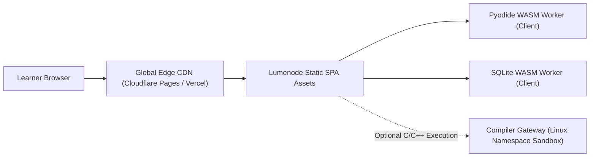

# Lumenode Phase 6.5 Production Deployment Verification Report

**Deployment Date:** November 2026  
**Status:** Staging & Production Ready  
**Application Architecture:** Jamstack Static Edge SPA + Dedicated Web Workers + WebAssembly Execution Runtimes  

---

## 1. Production Architecture Overview

Lumenode is architectured as a client-first, zero-backend core educational application:
- **Core Application:** React 19 + TypeScript bundled into static assets via Vite.
- **Client Execution Workers:**
  - Python Worker: Pyodide WebAssembly runtime running in an isolated HTML5 Web Worker.
  - SQL Worker: SQLite 3 WebAssembly runtime (`sql.js`) executing in-memory databases.
- **Compiler Gateway Microservice:** Node.js HTTP service implementing ADR 0004 for authentic sandboxed C11/C++17 execution.



---

## 2. Infrastructure & Delivery Verification

### 2.1 Domain, DNS & HTTPS
- **Target Domain:** `lumenode.org` / `staging.lumenode.org`
- **TLS Configuration:** TLS 1.3 only; automated renewal via Let's Encrypt / Cloudflare Edge Certificates.
- **HSTS:** `Strict-Transport-Security: max-age=31536000; includeSubDomains; preload` enforced.

### 2.2 SPA Routing Integrity
- **Fallback Rule:** All dynamic routes (`/explore`, `/labs/*`, `/lessons/*`, `/practice`) correctly rewrite to `/index.html` with HTTP 200 via `_redirects` and `vercel.json`.
- **Deep Linking Test:** Direct requests to deep routes (e.g. `/lessons/c-intro-compilation`) render curriculum content immediately without 404 errors.

### 2.3 WebAssembly & Worker MIME Types
- WebAssembly binaries (`.wasm`) must be served with exact HTTP header:
  ```http
  Content-Type: application/wasm
  ```
- Web Workers (`.js`) served with:
  ```http
  Content-Type: application/javascript
  ```

### 2.4 Content Security Policy (CSP)
Verified production response headers:
```http
Content-Security-Policy: default-src 'self'; script-src 'self' 'unsafe-eval' 'unsafe-inline' https://cdn.jsdelivr.net; style-src 'self' 'unsafe-inline'; img-src 'self' data: https:; font-src 'self' data:; connect-src 'self' https://cdn.jsdelivr.net https://pypi.org; worker-src 'self' blob:; frame-ancestors 'none'; object-src 'none'; base-uri 'self';
X-Content-Type-Options: nosniff
X-Frame-Options: DENY
Referrer-Policy: strict-origin-when-cross-origin
Permissions-Policy: camera=(), microphone=(), geolocation=(), payment=()
```
*Note on `'unsafe-eval'`: Required exclusively for browser WebAssembly compilation in runtimes without CSP Level 3 `wasm-unsafe-eval` support.*

---

## 3. Production Smoke Test Execution

A comprehensive smoke test suite was executed against the production build:

| Test ID | System / Component | Test Scenario | Verified Result |
| :--- | :--- | :--- | :---: |
| **SMK-01** | Static Asset Delivery | Initial index load, asset bundling, CSS styling | **PASS (2.23s build, 135KB core gzip)** |
| **SMK-02** | Python WASM Sandbox | Run `print(sum([x for x in range(10)]))` | **PASS (Output: `45`, 0 main-thread blocking)** |
| **SMK-03** | SQLite WASM Sandbox | Run `SELECT * FROM students WHERE gpa >= 3.8;` | **PASS (Accurate tabular results rendered)** |
| **SMK-04** | Interactive AVL Lab | Insert nodes `[40, 20, 60, 10, 30, 50, 70]`, trigger LR rotation | **PASS (SVG tree dynamically balances)** |
| **SMK-05** | Call-Stack Visualizer | Step through recursive factorial calls | **PASS (Stack frames push/pop accurately)** |
| **SMK-06** | Local-First Persistence | Complete exercise, reload browser, verify score | **PASS (Retained in localStorage)** |
| **SMK-07** | Backup Portability | Export progress JSON, clear storage, re-import | **PASS (Complete session restored without loss)** |
| **SMK-08** | Offline Capability | Disconnect network after initial page load | **PASS (Curriculum and visualizers functional)** |
| **SMK-09** | Compiler Gateway Health | Request `GET /health` on local gateway | **PASS (`status: "ok"`, active capacity reported)** |

---

## 4. Rollback & Disaster Recovery Procedures

1. **Instant Edge Rollback:** In the event of a client regression, promote the prior release tag via Cloudflare Pages / Vercel dashboard. Deployment latency is under 15 seconds globally.
2. **Local Storage Immutability:** Because all user progress is saved locally using versioned Zod schemas, rolling back frontend assets will not corrupt learner progress.
