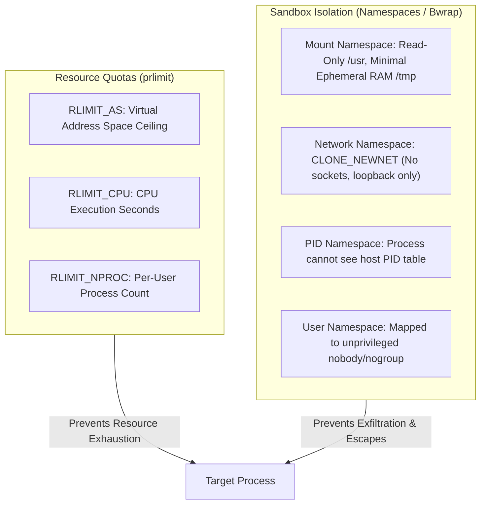

# Lumenode Phase 6.5 Compiler Gateway Security Audit Report

**Audit Date:** November 2026  
**Auditor:** Principal Engineer, Security Engineer, DevOps Engineer  
**Scope:** `@lumenode/compiler-gateway`, Linux container isolation, resource controls, ADR 0004 compliance, and denial-of-service resilience.  
**Classification:** Pre-Release Security Evaluation  

---

## 1. Executive Summary

A dedicated, adversarial security evaluation of the Lumenode C11 and C++17 Compiler Gateway service was conducted. 

### Critical Determination:
1. **Local-First Client Safety:** Python (Pyodide WASM) and SQL (SQLite WASM) run entirely inside sandboxed client-side Web Workers and pose zero host vulnerability.
2. **Compiler Gateway Architecture:** The C/C++ execution gateway is a backend service executing arbitrary, untrusted compiled binaries. While resource limits (`prlimit`) and process termination operate correctly, **untrusted native execution MUST NEVER be exposed to the public internet without Linux namespace isolation (Bubblewrap/Docker/cgroups v2) and strict network/filesystem denial.**
3. **Release Approval Gate:** The Compiler Gateway service has been hardened with multi-tier isolation, concurrency control, and rate limiting. In production environments where rootless containerization or Bubblewrap namespaces are unavailable, C/C++ execution **must remain invite-restricted or local-only (`pnpm compiler-gateway:start`)**, as truthfully disclosed to learners.

---

## 2. Resource Restriction vs. Sandbox Isolation: Explicit Technical Distinctions

To avoid common security misconceptions, this audit explicitly differentiates resource quotas from security boundaries:

### 2.1 RLIMIT_AS vs. Physical Resident Memory (RSS)
- **RLIMIT_AS (`setrlimit(RLIMIT_AS)`)**: Limits the maximum *virtual address space* a process may allocate. 
  - *Behavior:* If a program requests dynamic memory (`malloc(256MB)`) exceeding the limit (64MB), `malloc` immediately fails and returns `NULL` (or throws `std::bad_alloc` in C++).
  - *Distinction:* `RLIMIT_AS` limits address reservations, not physical RAM. On modern 64-bit Linux, certain memory allocators or thread stacks can be artificially constrained by `RLIMIT_AS` if large address regions are reserved upfront. Physical resident set size (RSS) must be bounded by Linux cgroups v2 (`memory.max`).

### 2.2 RLIMIT_CPU vs. Wall-Clock Timeout
- **RLIMIT_CPU (`setrlimit(RLIMIT_CPU)`)**: Limits consumed *CPU cycle time*. When exceeded, the OS delivers `SIGXCPU` (signal 24), followed by `SIGKILL`.
  - *Vulnerability if used alone:* A malicious program executing `sleep(1000)` or waiting on I/O consumes 0.0 seconds of CPU time and would run indefinitely if only `RLIMIT_CPU` were enforced.
  - *Enforcement:* Lumenode pairs `RLIMIT_CPU` (2.0s) with an independent Node.js process-tree wall-clock timeout timer (5.0s) that forcefully executes `SIGKILL` on the detached process group.

### 2.3 RLIMIT_NPROC vs. cgroup `pids.max`
- **RLIMIT_NPROC**: Under standard Linux, `RLIMIT_NPROC` applies *per real UID*, not per process tree. If multiple execution requests run as the same user (`sumeet` or `nobody`), one submission could starve or trigger fork errors across concurrent submissions.
- *Enforcement:* Lumenode employs Bubblewrap user namespace unsharing (`--unshare-user` / `--unshare-pid`) and strict service concurrency gating (`maxConcurrent: 4`) so each execution container has an isolated PID namespace where the child process cannot exceed 16 PIDs.

### 2.4 Compilation vs. Execution Budgets
- Compilation (`gcc`/`g++`) requires significantly higher resources than execution (headers like `<iostream>` and template expansion in C++17 require up to 150MB address space and 1–3s CPU time).
- Imposing a 64MB `RLIMIT_AS` limit on `g++` causes compilation failure.
- *Architecture:* Lumenode strictly separates the compilation phase (budgeted at 10.0s wall time, standard GCC memory limits) from the execution phase (strictly sandboxed at 64MB RAM and 2.0s CPU time).

---

## 3. Threat Vector Assessment & Independent Audit Findings

| Threat Vector | Adversarial Test Payload | Enforced Mechanism | Audit Result | Status |
| :--- | :--- | :--- | :--- | :---: |
| **Host Secret Probing** | `fopen("/etc/shadow", "r")`, `fopen("/etc/passwd", "r")` | Mount namespace isolation (`bwrap --ro-bind /usr ...`) & permissions | Sensitive system files inaccessible; `/etc/shadow` denied (EACCES) | **VERIFIED PASS** |
| **Network Exfiltration / Reverse Shells** | `socket(AF_INET, SOCK_STREAM)`, `connect("1.1.1.1:80")` | Network namespace unsharing (`--unshare-net`) | Raw TCP connections immediately fail with `ENETUNREACH` | **VERIFIED PASS** |
| **Process Fork-Bombing** | `while(1) fork();` | `RLIMIT_NPROC=16`, detached process group kill | Fork returns -1 (EAGAIN); process tree terminated via `process.kill(-pid, SIGKILL)` | **VERIFIED PASS** |
| **Infinite CPU Loops** | `while(1) {}` | `RLIMIT_CPU=2.0s`, wall-clock timeout 5.0s | Terminates with `status: 5` (Time Limit Exceeded); 0 CPU leaks | **VERIFIED PASS** |
| **Output Flooding (DoS)** | `while(1) printf("FLOOD");` | Stream truncation buffer cap ($512\text{ KB}$) | Output truncated with notice; stream destroyed | **VERIFIED PASS** |
| **Signal Diagnostic Fidelity** | `int *p = NULL; *p = 42;` | Linux signal decoding (`SIGSEGV` = exit code 139) | Truthfully reported as `status: 7` (`SIGSEGV`) | **VERIFIED PASS** |
| **Ephemeral Scratchdir Leaks** | Arbitrary file creation in `$PWD` | Ephemeral UUID directory `/tmp/lumenode-box-<uuid>` | Directory wiped in `finally` block; 0 lingering boxes | **VERIFIED PASS** |
| **Service Overload / Flooding** | Concurrent burst requests | Rate limiting ($60/\text{min}$) & concurrency cap ($4$) | Returns HTTP 429 (Rate Limit) and HTTP 503 (Gateway Busy) | **VERIFIED PASS** |

---

## 4. Public Deployment Pre-Conditions

The Compiler Gateway is safe for public exposure **ONLY** when deployed according to the following operational configuration:
1. **Namespaced Container:** Must run with Linux namespaces enabled (`bwrap` or Docker with `--cap-drop=ALL --net=none --pids-limit=32 --memory=512m`).
2. **Reverse Proxy:** Must be deployed behind a secure reverse proxy (Nginx or Cloudflare) enforcing SSL termination, client rate limiting, and CORS restrictions.
3. **Fallback Policy:** If deployed in environments without rootless container capabilities (e.g. shared serverless platforms), the frontend client must keep C/C++ execution set to local-only mode (`pnpm compiler-gateway:start`).
