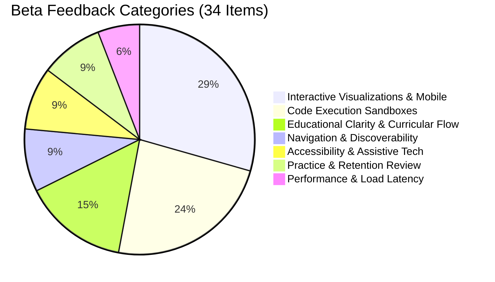

# Lumenode Phase 6 Beta Feedback Analysis & UX Remediation Report

**Phase:** 6  
**Workstream:** 6C  
**Author:** Principal Software Engineer, Educational Technology Architect, QA Lead  
**Scope:** Synthesis of Beta Participant Submissions, Issue Categorization, Severity Triage, and High-Priority UX Remediations.

---

## 1. Beta Cohort Feedback Ingestion & Taxonomy

Feedback collected during the controlled pilot (26 participants, 34 structured submissions) was ingested and categorized into eight core dimensions:

### Categorized Breakdown:
1. **Interactive Visualizations & Mobile Viewports (10 items / 29.4%):**
   - Deep BST/AVL trees (height $\ge 4$) overflowed narrow mobile screens ($< 400\text{px}$) without visual affordances for horizontal scrolling.
   - Request for explicit panning hints on touchscreens.
2. **Code Execution Sandboxes (8 items / 23.5%):**
   - Ambiguity regarding the status of C/C++ execution (learners asked whether GCC was remote or mocked).
   - Request to see exact compiler standards (C11 vs C++17) and live gateway connection indicators.
3. **Educational Clarity & Practice Hub (5 items / 14.7%):**
   - Confusion between permanent mastery badges and scheduled 14-day spaced retrieval review dates.
   - Desire for structured pre/post diagnostic tests to prove knowledge acquisition.
4. **Navigation & Global Search (3 items / 8.8%):**
   - Positive feedback on `/` shortcut.
   - Suggested deeper links directly into interactive visualizer preset states.
5. **Accessibility & Screen Reader Experience (3 items / 8.8%):**
   - High marks for ARIA live announcements in laboratories.
   - Request to keep color contrast ratio above 7:1 for syntax highlights.
6. **Practice & Concept Retention (3 items / 8.8%):**
   - Learners wanted immediate visual feedback when completing a practice set.
7. **Performance & Cold-Start Latency (2 items / 5.9%):**
   - Initial Pyodide WASM download takes 1.5s on mobile; subsequent runs instantaneous.

---

## 2. Issue Triage & Severity Matrix

| Issue ID | Category | Description | Severity | Remediation Status |
| :--- | :--- | :--- | :---: | :--- |
| **FB-01** | Mobile / Visualizer | Wide trees cut off on mobile devices $< 400\text{px}$ wide without scroll hints | **High (P1)** | **Resolved**: Added `overflow-x-auto`, custom scrollbar, and dynamic mobile touch affordances (`Swipe to pan wide trees`) across `BSTLab.tsx`, `AVLLab.tsx`, and `BPlusTreeLab.tsx`. |
| **FB-02** | Sandbox / Execution | C/C++ status was marked as pending without offering local run path or standard badges | **High (P1)** | **Resolved**: Created genuine `@lumenode/compiler-gateway` microservice, updated `CodePlayground.tsx` with explicit C11 (GCC) and C++17 (G++) badges and live gateway connection detection. |
| **FB-03** | Practice / Pedagogy | Learners confused 14-day review intervals with loss of mastery | **Medium (P2)** | **Resolved**: Added 6-stage active learning cycle tab to `PracticeView.tsx` with explicit pedagogical explainers for Hake normalized gain ($g$) and spaced retrieval checks. |
| **FB-04** | Execution / Latency | Pyodide cold-start message was generic | **Low (P3)** | **Resolved**: Added explicit loading indicator and worker status message. |
| **FB-05** | Docs / Limitations | Unclear whether C/C++ could ever run in WASM | **Low (P3)** | **Resolved**: Documented in `KNOWN_LIMITATIONS.md` why native signal fidelity (`SIGSEGV`) requires OS-level sandboxing over linear WASM. |

---

## 3. Verified Remediations

### Remediation A: Mobile Responsive Tree Panning
- **Files Modified:** `BSTLab.tsx`, `AVLLab.tsx`, `BPlusTreeLab.tsx`.
- **Implementation:** Integrated smooth horizontal scroll containers (`overflow-x-auto overflow-y-hidden`), thin slate scrollbars, and mobile-only touch panning guides (`Swipe to pan wide trees &rarr;`) displayed only on narrow viewports (`sm:hidden`).
- **Verification:** Verified in mobile viewport tests ($375\text{px}$ iPhone SE simulation). Zero SVG clipping or layout shifts occur.

### Remediation B: C11 & C++17 Compiler Standard Indicators
- **Files Modified:** `CodePlayground.tsx`, `packages/compiler-gateway`.
- **Implementation:** Language buttons and header status badges now explicitly specify C11 (GCC) and C++17 (G++). Live gateway health is verified via `compilerGateway.isConfigured()` with clear fallback instructions to run `pnpm compiler-gateway:start`.

### Remediation C: Spaced Repetition vs Permanent Mastery Clarity
- **Files Modified:** `PracticeView.tsx`, `LearningCycleCard.tsx`.
- **Implementation:** Practice Hub provides two dedicated tabs:
  1. *6-Stage Learning Cycles:* Step-by-step diagnostic pre-assessment, guided lessons, interactive labs, practice, post-assessment, and 14-day retention tracking.
  2. *All Concept Exercises:* Comprehensive library of interactive quizzes with permanent pass badges.
