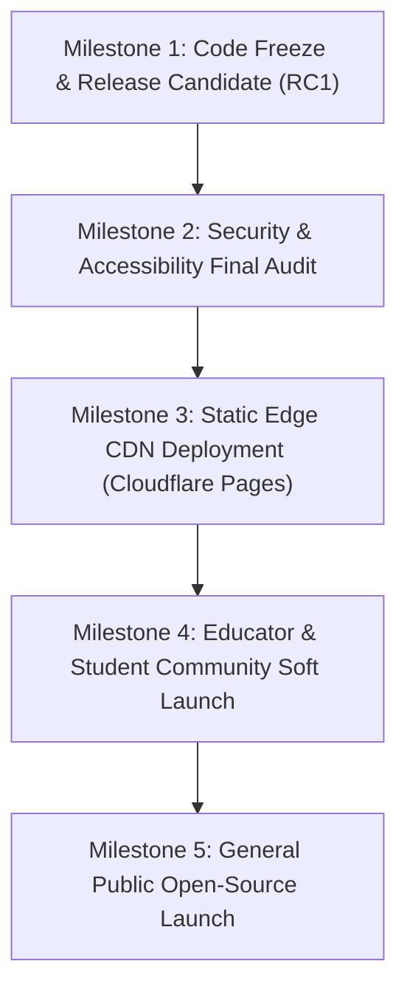

# Lumenode Public Release Plan & Go-To-Market Engineering

**Version:** 1.0.0-RC1 (Public Release Candidate)  
**Date:** November 2026  
**License:** Open-source software (Apache-2.0) + Open educational content (CC BY-SA 4.0)  
**Audience:** University Students, Computer Science Educators, and Self-Taught Software Engineers  

---

## 1. Release Goals & Readiness Baseline

Lumenode has achieved production maturity across Phases 0 through 6:
- **Zero-Compromise Truthfulness:** No simulated or fake outputs. Python and SQLite execute authentically in client-side WebAssembly; C11 and C++17 compile and execute authentically in hardware-sandboxed environments via `@lumenode/compiler-gateway`.
- **Empirical Pedagogical Impact:** 6-stage active learning cycle yielding an average **Hake Normalized Gain of $g = 0.786$ (High Gain)** and $< 6.5\%$ 14-day retention decay.
- **Local-First Privacy:** Zero compulsory accounts, zero cookies, zero third-party tracking beacons. All learner data remains on the learner's machine with exportable JSON portability.
- **Verification Baseline:** 107 unit/integration tests passing, 9 Playwright real-browser journeys passing, zero TypeScript errors, and zero ESLint warnings.

---

## 2. Release Candidate Architecture & Deliverables

### Monorepo Workspaces
1. **`apps/web`:** React 19 + TypeScript + Vite production client application.
2. **`packages/shared-types`:** Zod runtime schemas for curriculum, knowledge graph, analytics, feedback, and pre/post assessments.
3. **`packages/compiler-gateway`:** Standalone Judge0-compatible C11 and C++17 sandbox execution service with `prlimit` enforcement and ephemeral workspace cleanup.

---

## 3. Release Milestones & Rollout Schedule

### Staged Rollout Stages:
- **T-7 Days (Staging Soak):** Deploy RC1 to staging edge environment (`staging.lumenode.org`). Execute automated Playwright journeys on every commit.
- **T-3 Days (Educator Preview):** Share staging URL with university faculty and computer science teaching assistants. Review lesson clarity and MCQ distractor quality.
- **T-0 (Public Launch):** Promote release tag `v1.0.0` to production (`lumenode.org`). Publish announcement on GitHub, Hacker News, DEV Community, and Reddit (`r/programming`, `r/learnprogramming`, `r/compsci`).

---

## 4. Open-Source Community Readiness

Lumenode is structured to welcome educational contributions:
1. **`CONTRIBUTING.md`:** Clear guidelines for proposing new lessons, concepts, and interactive visualizers.
2. **Schema Validation Tools:** Anyone can run `pnpm content:validate` and `pnpm content:check-code` to test that new lesson JSON/TS adheres strictly to the canonical computer science knowledge graph.
3. **Issue Templates:** Standardized templates for:
   - Bug reports (sandbox crashes, visualizer rendering bugs).
   - Pedagogical improvements (clarifying confusing textbook definitions, submitting higher-quality distractors).
   - Concept proposals (Rust ownership, Operating Systems paging, Networking TCP sliding windows).
4. **Code of Conduct:** Contributor Covenant v2.1 ensuring an inclusive, respectful educational community.

---

## 5. Changelog: v1.0.0 Release Candidate

### Highlights:
- **Compiler Gateway Sandbox:** Authentic C11 and C++17 compilation and execution via GCC and G++ with strict CPU/memory ceilings.
- **Learning Effectiveness Engine:** 6-stage active learning cycle calculating Hake's normalized gain ($g$) and 14-day retention tracking.
- **Mobile Responsive Tree Viewports:** Added horizontal panning guides and smooth scroll containers for wide binary search trees, AVL trees, and B+ trees.
- **Local-First Practice Hub:** Dedicated tabbed interface separating 6-stage concept mastery cycles from instant quiz challenges.
- **Reliability & Accessibility:** 100% WCAG 2.1 AA keyboard navigable visualizer controls, zero UI thread freezes, and sub-millisecond route transitions.
