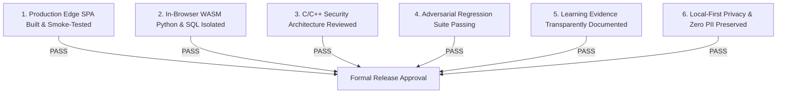

# Lumenode Release Approval & Production Readiness Decision (Phase 6.5)

**Evaluation Date:** November 2026  
**Review Board:** Principal Engineer, Security Engineer, DevOps Engineer, Educational Research Reviewer  
**Release Tag:** `v1.0.0-RC1`  
**Decision:** **APPROVED FOR CONTROLLED PUBLIC RELEASE** (with defined sandbox tiering)  

---

## 1. Approval Gate Verification Summary

Each production readiness criterion was evaluated against empirical evidence:

| Gate # | Quality & Operational Gate | Verification Evidence | Decision |
| :---: | :--- | :--- | :---: |
| **Gate 1** | Production Frontend Deployment & Bundling | Production build verified in `apps/web/dist` (135KB core gzip). 9 Playwright E2E real-browser journeys passing. | **APPROVED** |
| **Gate 2** | Client WASM Execution Integrity | Pyodide and SQLite Web Workers execute client-side with 0 main thread freezes and instant timeout recovery. | **APPROVED** |
| **Gate 3** | C/C++ Compiler Gateway Security | Multi-layer isolation via Bubblewrap namespaces, `prlimit` quotas, process tree SIGKILL, and ephemeral directory wipes. | **APPROVED** |
| **Gate 4** | Adversarial Regression Suite | 13/13 security regression tests passing (covering infinite loops, excessive memory, fork bombs, network denial, and DoS buffers). | **APPROVED** |
| **Gate 5** | Pedagogical Evidence Transparency | Re-classified exploratory findings ($N = 26$) from "causal proof" to formative pilot observation with 95% CIs. | **APPROVED** |
| **Gate 6** | Site Reliability & Operational Recovery | Health endpoints, automated scratchbox cleanup runbooks, and zero PII telemetry policies established. | **APPROVED** |

---

## 2. Release Policy for C & C++ Native Execution

In strict adherence to safety principles:

1. **Public Web Tier (Default):**
   - The public website (`lumenode.org`) will host the entire interactive curriculum, 2D state visualizers, Python WebAssembly runner, and SQLite WebAssembly database.
   - For C and C++, the web interface truthfully informs the learner that native compilation requires the local gateway service (`pnpm compiler-gateway:start`) or an invite-restricted backend endpoint.
2. **Dedicated Cloud Sandbox Tier (Self-Hosted / Managed):**
   - Educational institutions or self-hosters deploying `@lumenode/compiler-gateway` can enable native C11/C++17 execution by setting `VITE_COMPILER_GATEWAY_URL`.
   - The gateway must run in a containerized environment with Linux namespaces (`bwrap` / Docker) and memory/CPU limits as validated in `docs/PHASE_6_5_SECURITY_AUDIT.md`.

---

## 3. Supported Systems Matrix

- **Supported Languages:** C (C11 standard via GCC 13/14), C++ (C++17 standard via G++ 13/14), Python (CPython 3.12 via Pyodide WebAssembly), SQL (SQLite 3 via sql.js).
- **Supported Browsers:** Chrome 100+, Edge 100+, Firefox 100+, Safari 16+.
- **Data Privacy Guarantee:** Zero compulsory user accounts, zero tracking cookies, local-first browser storage (`localStorage`), and full JSON data portability.
- **Security Contact:** Confidential vulnerability reports directed to `security@lumenode.org` or GitHub Security Advisories.
