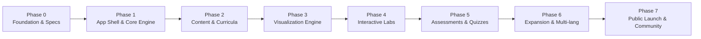

# Lumenode Execution Roadmap

## Phase Overview

---

### Phase 0: Product Foundation (Current)
- [x] Comprehensive PRD, Architecture, and Data Model specifications (`docs/`).
- [x] Monorepo structure and repository conventions established.
- [x] Design token definitions and dark-mode palette setup.
- [x] Initial curriculum and subject scope alignment.

### Phase 1: Platform Foundation
- [ ] React 19 + TypeScript + Vite workspace setup.
- [ ] Responsive navigation shell (Sidebar, Breadcrumbs, Command Palette `Cmd+K`).
- [ ] Local persistence layer (`progress-engine` using IndexedDB).
- [ ] Dynamic lesson renderer supporting Markdown, code snippets, and callouts.
- [ ] Subject and topic browsing views.

### Phase 2: Educational Content (Initial 30-50 Lessons)
- [ ] C Fundamentals: Syntax, pointers, arrays, dynamic memory (`malloc`/`free`).
- [ ] C++ Fundamentals: References, classes, templates, STL basics.
- [ ] Python Fundamentals: Dynamic typing, data structures, OOP vs functions.
- [ ] Core CS — Data Structures: Linked Lists, Stacks, Queues, Binary Trees.
- [ ] Core CS — OOP: Encapsulation, Polymorphism, Inheritance, Composition.
- [ ] Core CS — Memory: Stack vs. Heap layout, pointer dereferencing, buffer overflows.
- [ ] Core CS — DBMS: Relational model, Keys, Normalization, SQL fundamentals.

### Phase 3: Visualization Engine
- [ ] Step-based playback controller (Play, Pause, Step Next, Step Prev, Speed slider).
- [ ] Interactive 2D DSA Visualizer (Array pointers, Linked list mutations, Tree traversals).
- [ ] Memory & Pointer Simulator (Visual stack frames, heap addresses, pointer links).
- [ ] OOP Class & Inheritance diagram generator.

### Phase 4: Practical Laboratories
- [ ] In-browser SQLite WASM Playground with sample university datasets.
- [ ] Monaco Code Editor integration with syntax validation.
- [ ] Code Execution Adapter (Mock/Local sandbox fallback + Remote Compiler Gateway client).
- [ ] Standard Input/Output console panel.

### Phase 5: Assessment Engine
- [ ] Interactive MCQ and short-answer components with instant feedback and explanations.
- [ ] "Predict the Output" trace challenges.
- [ ] Coding challenge verification runner.
- [ ] Progress dashboard with strength/weakness indicators.

### Phase 6: Expansion & Ecosystem
- [ ] Additional languages: Java, Rust, TypeScript, Go.
- [ ] Extended subjects: Operating Systems, Computer Networks, Compilers.
- [ ] Cross-language concept comparison split views.

### Phase 7: Public Open-Source Launch
- [ ] Public documentation, contribution guidelines, issue templates.
- [ ] Comprehensive test suite and CI/CD pipelines.
- [ ] Accessibility (WCAG 2.1 AA) and performance audits.
